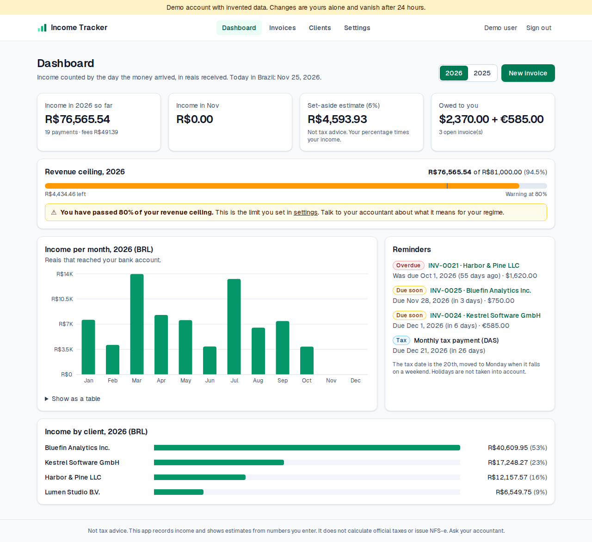

# Income Tracker

Invoices in dollars and euros, income in reais. A small full-stack app for a Brazilian contractor
(PJ) who bills foreign clients: create English PDF invoices, record when each payment actually
lands, and watch monthly and yearly income against a revenue ceiling.

**Demo:** _add the Vercel URL here_ · click **Try the demo**, no sign-up needed.



## The problem

I'm a Brazilian contractor, and my clients pay in USD or EUR. What counts for my income is the
reais that reach my bank after the spread and fees, on the day they arrive. Spreadsheets got that
wrong in small ways: wrong month, float rounding, a forgotten invoice.

## Features

- **Invoices** with line items, a live total, due dates and gap-free numbering, downloadable as a
  clean English PDF.
- **Payments** recorded in the invoice's currency and in the reais that actually arrived, next to
  the Banco Central PTAX reference rate and the difference between them.
- **Dashboard** with income per month and per client in BRL, and a warning at 80% and 100% of a
  revenue ceiling you set yourself.
- **Reminders** for overdue invoices, invoices due within 7 days and the monthly tax payment date.
- **Demo mode**: every visitor gets their own throwaway account filled with invented data.

## Stack, and why

| Area           | Choice                                                               | Why                                                                                                              |
| -------------- | -------------------------------------------------------------------- | ---------------------------------------------------------------------------------------------------------------- |
| Framework      | Next.js 16 (App Router) + TypeScript                                 | Server components for reads, server actions for writes, one deploy                                               |
| Database       | PostgreSQL + Prisma 7                                                | Invoices, items and payments are relational, and numbering needs transactions                                    |
| Auth           | Auth.js v5 with GitHub, plus a guest provider for the demo           | Enough for a portfolio app; ownership is checked on the server either way                                        |
| Money          | Integer minor units and one `money` helper                           | Floating-point money is the classic bug                                                                          |
| Forms          | React Hook Form + Zod, one schema per form, used on both sides       | The browser validates for convenience, and the server validates again on the raw values                          |
| PDF            | `@react-pdf/renderer` on the server, with an embedded font           | A designed invoice without a headless browser; the embedded font makes `ã` and `€` look the same in every viewer |
| Exchange rates | Banco Central PTAX, cached in the database, manual entry as fallback | Official, free, and the app still works when the API is down                                                     |
| Dates          | `date-fns` + `@date-fns/tz`, `America/Sao_Paulo`, `@db.Date` columns | Month boundaries and the "20th" reminder depend on the Brazilian calendar                                        |
| Charts         | Recharts for income per month; plain HTML bars for income by client  | Each has a table or text alternative                                                                             |
| Tests          | Vitest (unit + integration against Postgres), Playwright + axe       | The tests sit on the business rules, where a bug would cost real money                                           |

## How money is handled

- Every amount is an `Int` in the smallest unit: cents for USD/EUR, centavos for BRL. Quantities
  are hundredths (7.5 hours is `750`), exchange rates are millionths (`5.7324` is `5732400`).
- [`src/lib/money.ts`](src/lib/money.ts) is the only place money is rounded: `divideRounded`
  does exact `BigInt` division, rounding half away from zero. Line totals, conversions and
  percentages all go through it.
- Typed input is parsed from the string (`"1,234.56"` becomes `123456`) without ever becoming a
  float. Floats appear only at the very end, inside `Intl.NumberFormat`.
- Each line is rounded once, then the rounded lines are added. The form, the invoice page and
  the PDF all call the same `invoiceTotal`, so they always agree.
- Income is the **reais that reached your account**, typed by you and never overwritten. Fees
  are stored next to it for your records.

## Invoice status and numbering

- Only `DRAFT`, `SENT` and `VOID` are stored. **Paid, partly paid and overdue are derived**
  ([`src/lib/invoice-status.ts`](src/lib/invoice-status.ts)) from the payments and today's date
  in Brazil, so they can never go out of sync.
- A payment can mark an invoice as settled when an intermediary bank kept part of the money.
  This is common with SWIFT transfers.
- **Drafts have no number.** "Mark as sent" increments a per-user counter and assigns the number
  in one transaction. The increment locks the user's row, so concurrent sends get consecutive
  numbers, and a failure rolls the increment back. Deleting a draft can never leave a gap. Sent
  invoices can't be deleted, only voided, and a void invoice keeps its number.
- Payments can only be recorded on sent invoices. The rule is checked again inside the write
  transaction.

## Exchange rates (PTAX)

- Source: Banco Central's open data API (`CotacaoMoedaPeriodo`), Open Database License.
- **Rule: the sell rate (`cotacaoVenda`) of the closing bulletin (`Fechamento`) for the date the
  money arrived.** The bulletin used is stored on the payment.
- **Weekends and holidays** have no bulletin. The service asks for the 10 days up to the date
  and takes the latest closing bulletin on or before it, so a Saturday uses Friday's rate, or
  Thursday's when Friday is a holiday (as on 20 Nov 2026). The payment form says when this
  happens.
- Every bulletin fetched is cached in `ExchangeRate` and shared by all users. Weekends are
  answered from a cached Friday without calling the API.
- The request has a 5-second timeout. If the API fails, the form switches to **entering a rate
  by hand**, and you can also save with no reference at all.
- The rate is a reference only. The browser shows it as you type, but the server looks it up
  again on save rather than trusting a rate sent by the browser.

## What the app deliberately does not do

- **It does not calculate taxes.** Which taxes apply to exported services depends on the regime
  and on conditions that accountants and the Receita Federal argue about, and the tax reform is
  changing them. The app records and displays; your accountant decides. It offers a
  **set-aside percentage** (an estimate, labelled "not tax advice") and a free-text **tax
  treatment note** on each invoice.
- **The revenue ceiling is your number.** MEI (R$81,000) and Simples Nacional (R$4.8 million)
  are presets taken from accounting sites, not from an official source, and never hardcoded
  rules. How export revenue counts toward them is a question for your accountant.
- **It does not issue the NFS-e.** That comes from your city's system; the app only stores the
  number. The English PDF is the document for your client.
- **The tax-date reminder ignores holidays.** It is the 20th, moved to Monday when it falls on a
  weekend. A holiday calendar is left out on purpose.
- No bank connections, no multi-user companies, no accounting exports.

Every page carries a short "not tax advice" note.

## Security and privacy

- `requireUser()` in [`src/lib/session.ts`](src/lib/session.ts) is the only way server code
  learns who is signed in. Every page, server action and route handler calls it (or returns 401).
- Every function in [`src/server`](src/server) takes the user id and filters every query by it.
  Another user's record returns the same 404 as a missing one, so ids can't be probed.
  [`ownership.int.test.ts`](src/server/ownership.int.test.ts) shows that user B can't list, read,
  edit, send, void, duplicate, delete or pay user A's clients and invoices.
- Server actions re-validate the raw form values with the same Zod schema the browser used.
- The PDF route and the rates API check the session before doing anything.
- **Data lives in two places.** Your private deployment sets `DEMO_MODE_ENABLED=false` and uses
  its own database. The public demo has a separate database, no GitHub credentials, and only
  invented data, created by [`src/server/demo-data.ts`](src/server/demo-data.ts). Screenshots
  come from the demo. No real name, client, amount or bank detail is in this repository.

## Tests

```bash
npm test                  # unit: money, dates, status, ceiling, validation, PDF rendering
npm run test:integration  # Postgres: ownership, numbering, payments, PTAX fallback and cache
npm run test:e2e          # Playwright: the full flow, a weekend rate, axe checks, mobile overflow
```

The end-to-end flow signs in with the demo, creates a client and a three-item invoice (and checks
the live total), sends it, downloads the PDF, blocks the rate API to force a manual rate, records
the payment, and checks that the dashboard's year-to-date total grew by exactly the reais entered.

## Run it locally

```bash
cp .env.example .env      # then set AUTH_SECRET (npx auth secret)
docker compose up -d      # Postgres on port 5433, with an income_test database for tests
npm install
npx prisma migrate dev
npm run db:seed           # optional: demo@example.com with a year of fake data
npm run dev
```

GitHub sign-in needs an OAuth app (callback `http://localhost:3000/api/auth/callback/github`) and
`AUTH_GITHUB_ID` / `AUTH_GITHUB_SECRET`. Without them, only **Try the demo** is shown.

### Deploy

Vercel runs `npm run vercel-build` (migrations, then build). Set `DATABASE_URL`, `AUTH_SECRET`,
and either the GitHub variables (private deployment, `DEMO_MODE_ENABLED=false`) or nothing else
(public demo).

## Known gaps and what I'd do next

- The invoice PDF repeats the invoice number and client on every page but has no "Page X of Y"
  counter. react-pdf's render-prop text did not appear in this layout, and I left it out rather
  than ship a fragile workaround.
- The demo is a writable sandbox per visitor rather than a read-only account, so reviewers can
  try the whole flow. Sandboxes are deleted after 24 hours.
- Next: a second company per user (a `Company` table between `User` and the rest, with the same
  ownership filter), more currencies (the PTAX service already takes any ISO code; the enum and
  the client form are the only limits), a holiday calendar for the tax date, and a Portuguese
  interface.
